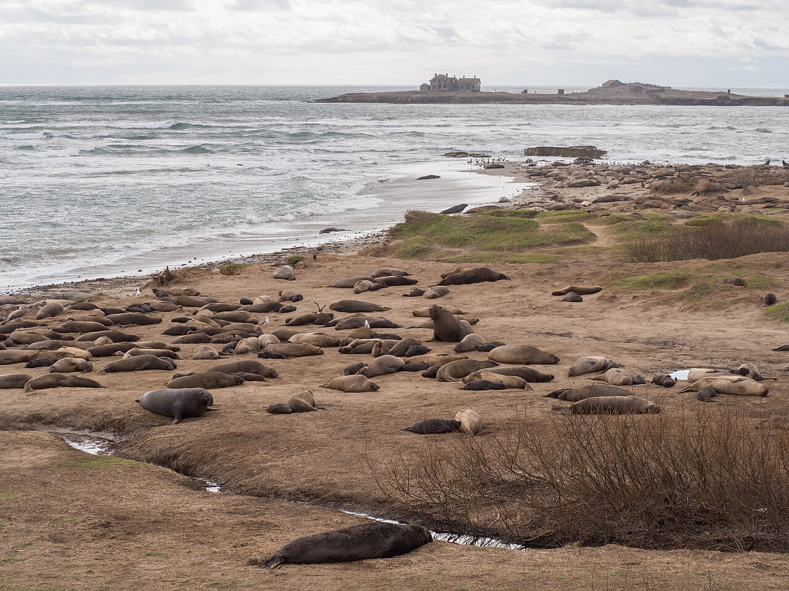
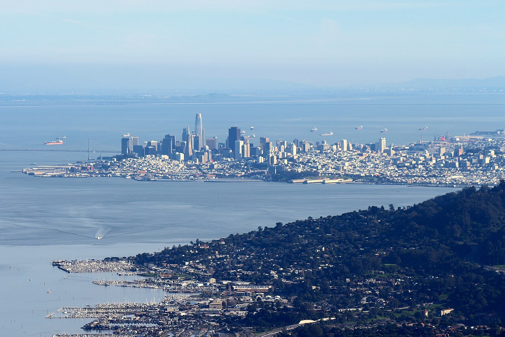
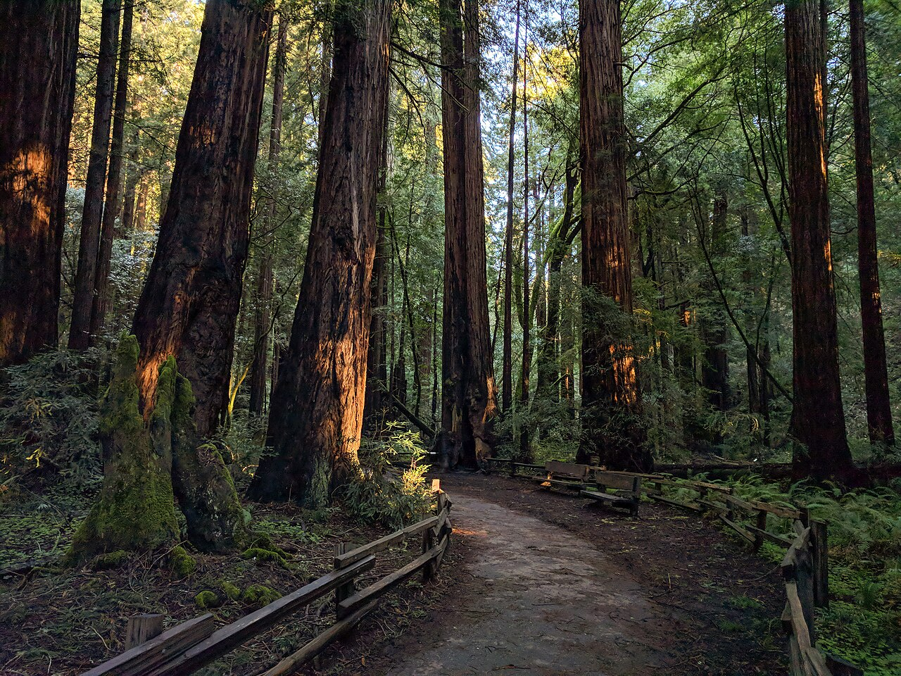
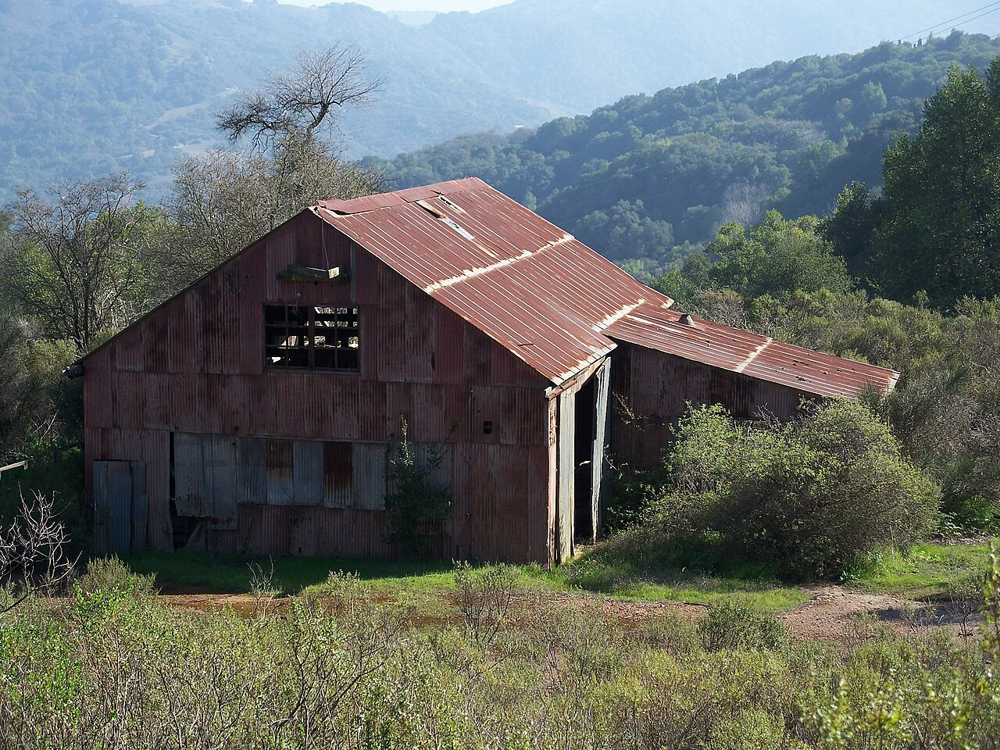
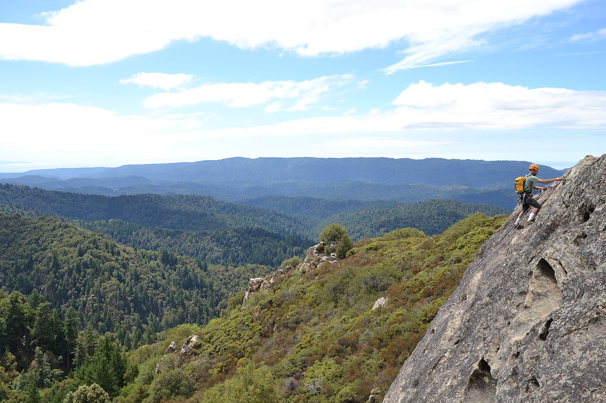
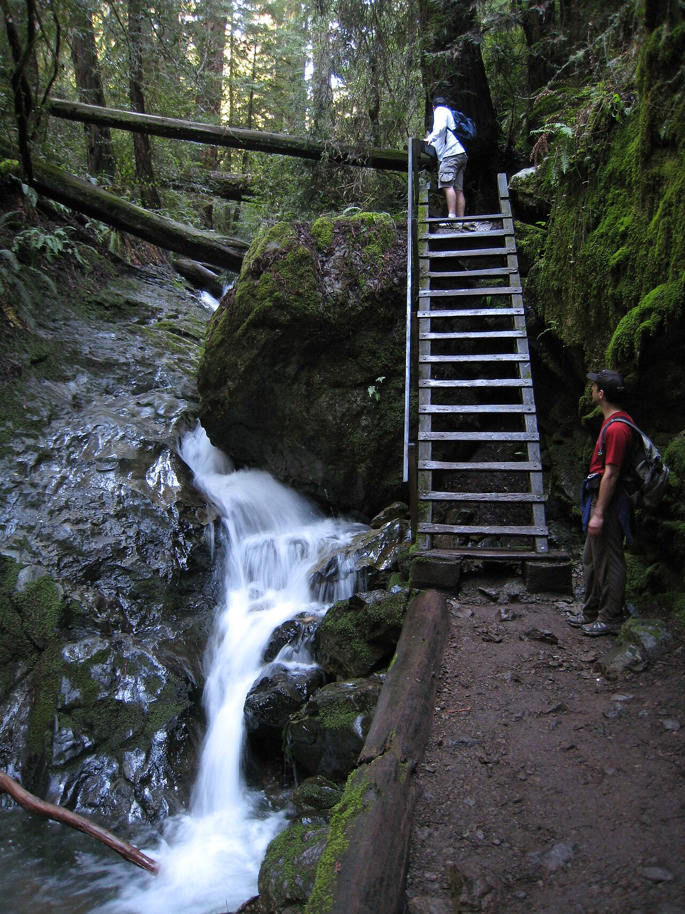
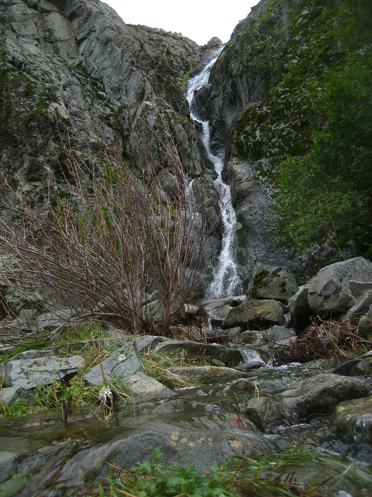
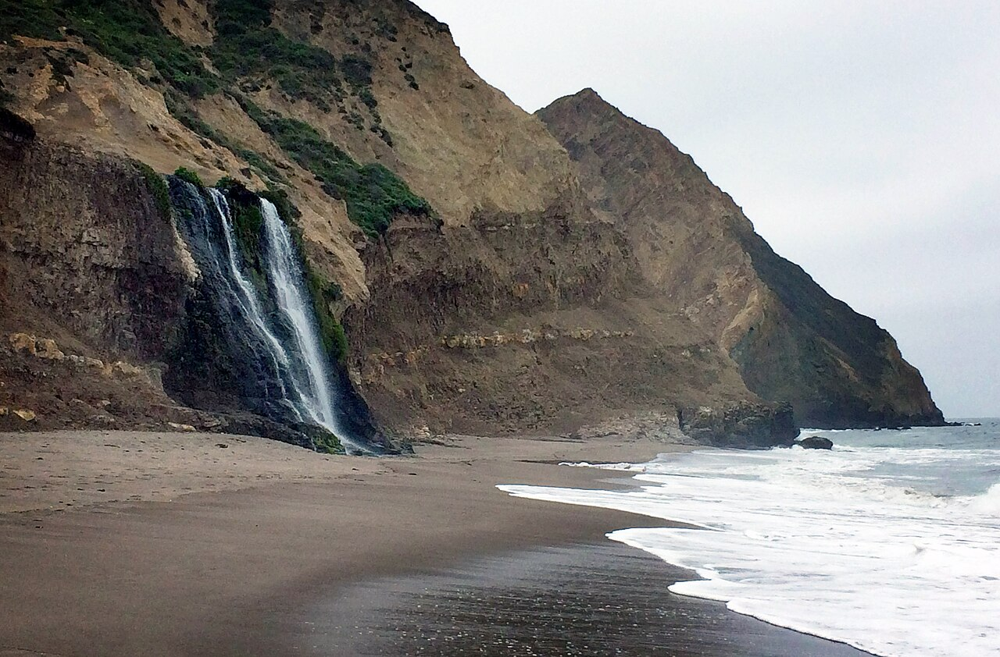

# Bay Area hikes

Printable guides to hikes within about an hour and a half of San Francisco, shortest first. Each is a PDF to print and carry; the [README](README.md) explains what goes into one and how to print it so it survives rain.

| Hike | Distance | Climb | Time | Grade |
|---|---|---|---|---|
| [Out to the elephant seals of Año Nuevo](#out-to-the-elephant-seals-of-ao-nuevo-ao-nuevo-state-park) (Año Nuevo State Park) | 4.2 mi | ≈ 230 ft | 2½–3 h | Easy |
| [The balcony of Mount Tam](#the-balcony-of-mount-tam-mount-tamalpais-state-park) (Mount Tamalpais State Park) | 4.7 mi | ≈ 800 ft | 2½–3 h | Easy–moderate |
| [Russian Ridge in bloom](#russian-ridge-in-bloom-russian-ridge-open-space-preserve) (Russian Ridge Open Space Preserve) | 5.0 mi | ≈ 1,000 ft | 2½–3 h | Easy–moderate |
| [Muir Woods, by the back door](#muir-woods-by-the-back-door-mount-tamalpais-state-park-and-muir-woods-national-monument) (Mount Tamalpais State Park and Muir Woods National Monument) | 5.8 mi | ≈ 1,150 ft | 3–3½ h | Moderate |
| [The ghost towns of Mine Hill](#the-ghost-towns-of-mine-hill-almaden-quicksilver-county-park) (Almaden Quicksilver County Park) | 6.0 mi | ≈ 1,300 ft | 3–3½ h | Moderate |
| [The cliff path at Castle Rock](#the-cliff-path-at-castle-rock-castle-rock-state-park) (Castle Rock State Park) | 6.1 mi | ≈ 1,710 ft | 3½–4½ h | Moderate |
| [Up the ladder from Stinson Beach](#up-the-ladder-from-stinson-beach-mount-tamalpais-state-park) (Mount Tamalpais State Park) | 7.2 mi | ≈ 1,850 ft | 4–5 h | Moderate |
| [The redwoods that came back](#the-redwoods-that-came-back-purisima-creek-redwoods-preserve) (Purisima Creek Redwoods Preserve) | 9.3 mi | ≈ 2,260 ft | 5–6 h | Strenuous |
| [Chasing the rain to Murietta Falls](#chasing-the-rain-to-murietta-falls-ohlone-regional-wilderness) (Ohlone Regional Wilderness) | 12.2 mi | ≈ 4,230 ft | 7–9 h | Strenuous |
| [The long way to Alamere Falls](#the-long-way-to-alamere-falls-point-reyes-national-seashore) (Point Reyes National Seashore) | 19.5 mi | ≈ 3,440 ft | 9–11 h | Strenuous |

## Out to the elephant seals of Año Nuevo (Año Nuevo State Park)

*Año Nuevo State Park, San Mateo coast, California · a half-day hike*

Photo: Rhododendrites, CC BY-SA 4.0 ([source](https://commons.wikimedia.org/wiki/File:Elephant_seals_at_Ano_Nuevo_(91629).jpg))

**The author has not done this hike. This guide is compiled from maps, agency pages and other hikers' reports.**

Walk two flat miles across old pasture and a field of dunes to the end of a point, and look down on a beach of animals the size of cars. In winter the bulls fight in the surf and the pups are born on the sand; for the rest of the year the seals come back in shifts to shed their skins. You go on the park’s terms: with a guide in winter, on a free permit otherwise.

**4.2 mi** there and back · **≈ 230 ft** gentle, plus one tall dune · **2½–3 h** · **Easy**: the last third is soft sand

[The guide (PDF)](out/ano-nuevo/ano-nuevo-elephant-seals.pdf) · [GPX](out/ano-nuevo/ano-nuevo-main.gpx)

## The balcony of Mount Tam (Mount Tamalpais State Park)

*Mount Tamalpais, Marin County, California · a half-day hike*

Photo: Pi.1415926535, CC BY-SA 4.0 ([source](https://commons.wikimedia.org/wiki/File:San_Francisco_and_Sausalito_from_Mount_Tam,_February_2026.JPG))

A loop along the sunny south face of the mountain, high above the fog: out on a contour path with San Francisco at your feet, lemonade on the porch of a 1904 railway inn, and home through cool forest.

**4.7 mi** loop · **≈ 800 ft** total climb & descent · **2½–3 h** · **Easy–moderate**: one real climb, at the end

[The guide (PDF)](out/west-point/mount-tam-west-point-loop.pdf) · [GPX](out/west-point/west-point-main.gpx)

## Russian Ridge in bloom (Russian Ridge Open Space Preserve)

*Russian Ridge Open Space Preserve, Santa Cruz Mountains, California · a half-day hike*

Photo: Steve Jurvetson, CC BY 2.0 ([source](https://commons.wikimedia.org/wiki/File:Russian_Ridge-Wildflowers.jpg))

Every April the open crest of the mountains above Silicon Valley turns orange with poppies and blue with lupine, and an easy loop takes you straight through it, with the Pacific on one side and the whole bay on the other. Hawks hang at eye level, newts cross the trail after rain, and the way home is through a grove of oaks older than the state. The price is wind, and no shade.

**5.0 mi** loop · **≈ 1,000 ft** total climb & descent · **2½–3 h** · **Easy–moderate**: rolling, never steep for long

[The guide (PDF)](out/russian-ridge/russian-ridge-borel-hill-ancient-oaks.pdf) · [GPX: main](out/russian-ridge/russian-ridge-main.gpx) · [GPX: short](out/russian-ridge/russian-ridge-short.gpx)

## Muir Woods, by the back door (Mount Tamalpais State Park and Muir Woods National Monument)

*Mount Tamalpais, Marin County, California · a half-day hike*

Photo: Matthew Dillon, CC BY 2.0 ([source](https://commons.wikimedia.org/wiki/File:Muir_Woods_National_Monument_(47879029461).jpg))

Start on the mountain at the Mountain Home Inn, walk down through quiet forest into the old-growth redwoods, and climb back out beside a creek to a deck with a view.

**5.8 mi** loop · **≈ 1,150 ft** total climb & descent · **3–3½ h** · **Moderate**: steep in places

[The guide (PDF)](out/muir-woods/muir-woods-back-door.pdf) · [GPX: main](out/muir-woods/muir-woods-main.gpx) · [GPX: short](out/muir-woods/muir-woods-short.gpx)

## The ghost towns of Mine Hill (Almaden Quicksilver County Park)

*Almaden Quicksilver County Park, San José · a half-day hike*

Photo: Eugene Zelenko, CC BY-SA 4.0 ([source](https://commons.wikimedia.org/wiki/File:USA-San_Jose-Almaden_Quicksilver_Park-English_Camp-3.jpg))

Climb a shaded gulch to a hill where two mining towns stood for half a century, and walk through what is left of them: a few tin-roofed sheds, a flagpole, a furnace rusting in the grass, one tunnel you can still step into. Their mine supplied the mercury the Gold Rush ran on. Some of it is still in the creek.

**6.0 mi** loop · **≈ 1,300 ft** total climb & descent · **3–3½ h** · **Moderate**: one steep climb, in shade

[The guide (PDF)](out/almaden-quicksilver/almaden-quicksilver-mine-hill-loop.pdf) · [GPX](out/almaden-quicksilver/almaden-quicksilver-main.gpx)

## The cliff path at Castle Rock (Castle Rock State Park)

*Castle Rock State Park, on the Skyline ridge above Saratoga · a day hike*

Photo: Oleg Alexandrov, CC BY-SA 3.0 ([source](https://commons.wikimedia.org/wiki/File:Castle_Rock_State_Park_9.JPG))

**The author has not done this hike. This guide is compiled from maps, agency pages and other hikers’ reports.**

Walk round a sandstone crag eaten into caves and honeycomb, stand over the lip of a waterfall, then follow a trail cut into an open mountainside with a forested valley under your left hand. You come back through oak and madrone woods. One short ledge on the way out needs a steady head.

**6.1 mi** loop · **≈ 1,710 ft** total climb, in pieces · **3½–4½ h** · **Moderate**: rocky, one exposed ledge

[The guide (PDF)](out/castle-rock/castle-rock-saratoga-gap-ridge-loop.pdf) · [GPX: main](out/castle-rock/castle-rock-main.gpx) · [GPX: short](out/castle-rock/castle-rock-short.gpx)

## Up the ladder from Stinson Beach (Mount Tamalpais State Park)

*Mount Tamalpais, Marin County, California · a day hike in two lengths*

Photo: Richard Wood, CC BY-SA 3.0 ([source](https://commons.wikimedia.org/wiki/File:The_famous_stairs_on_the_Steep_Ravine_trail_-_panoramio.jpg))

Leave the sand, climb a redwood canyon by stone steps, footbridges and one wooden ladder beside a waterfall, come down an open ridge with the Pacific in front of you, and walk from the end of the trail to a dinner table.

**7.2 mi** loop to Pantoll · **≈ 1,850 ft** total climb & descent · **4–5 h** · **Moderate**: one ladder; a long descent

[The guide (PDF)](out/steep-ravine/mount-tam-steep-ravine-from-stinson-beach.pdf) · [GPX: main](out/steep-ravine/steep-ravine-main.gpx) · [GPX: summit](out/steep-ravine/steep-ravine-summit.gpx)

## The redwoods that came back (Purisima Creek Redwoods Preserve)

*Purisima Creek Redwoods Preserve, on the Skyline ridge above Half Moon Bay · a day hike*

Photo: Oleg Alexandrov, CC BY-SA 4.0 ([source](https://commons.wikimedia.org/wiki/File:Purisima_Creek_Trail_5.JPG))

Drop from the ridge into a canyon that was cut to the ground a century ago and has grown itself a forest again, follow its creek, cross a hidden ravine on a footpath, and climb back out with the Pacific behind you. It is an upside-down hike: everything you walk down in the morning, you walk up in the afternoon.

**9.3 mi** loop · **≈ 2,260 ft** total descent & climb · **5–6 h** · **Strenuous**: the climb comes last

[The guide (PDF)](out/purisima-creek/purisima-creek-redwoods-loop.pdf) · [GPX: main](out/purisima-creek/purisima-creek-main.gpx) · [GPX: short](out/purisima-creek/purisima-creek-short.gpx)

## Chasing the rain to Murietta Falls (Ohlone Regional Wilderness)

*Ohlone Regional Wilderness, above Livermore · one of the bay area’s most strenuous day hikes*

Photo: Joe Navratil (Flickr), CC BY-NC-ND 2.0 ([source](https://www.flickr.com/photos/navratil/4302943546/))

Go within days of a winter storm and a stream you could step across slides a hundred feet down a rock face, six miles from the nearest road. To reach it you climb one ridge, drop off the back of it and climb a higher one. Then you do all of it again to get home.

**12.2 mi** out and back · **≈ 4,230 ft** total climb, a quarter of it on the way home · **7–9 h** · **Strenuous**: long and steep, on good trail

[The guide (PDF)](out/murietta-falls/ohlone-murietta-falls.pdf) · [GPX](out/murietta-falls/murietta-falls-main.gpx)

## The long way to Alamere Falls (Point Reyes National Seashore)

*Point Reyes National Seashore, an hour north of San Francisco · a very long day hike*

Photo: Doug Olson, CC BY-SA 3.0 ([source](https://commons.wikimedia.org/wiki/File:Wildcat_Waterfall_-_panoramio_(1).jpg))

Follow a forest valley down to the Pacific, walk the sand at low tide to a waterfall that lands on the beach, then climb home over the highest ground on the peninsula. It is 19 miles, and the tide table sets your alarm clock.

**19.5 mi** a loop · **≈ 3,440 ft** total climb, in four separate hills · **9–11 h** · **Strenuous**: for its length; the trails are easy

[The guide (PDF)](out/point-reyes/point-reyes-alamere-falls-wittenberg.pdf) · [GPX: main](out/point-reyes/point-reyes-main.gpx) · [GPX: short](out/point-reyes/point-reyes-short.gpx)

Figures are for the feet-and-miles edition. Each guide is 5 or 6 pages. Photos belong to their authors: see [CREDITS.md](CREDITS.md). Generated by `scripts/make_index.py`.
