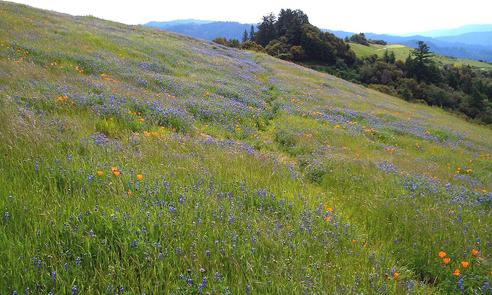

# Bay Area hikes

Printable guides to hikes within about an hour and a half of San Francisco, shortest first. Each is a PDF to print and carry; the [README](README.md) explains what goes into one and how to print it so it survives rain.

| Hike | Distance | Climb | Time | Grade |
|---|---|---|---|---|
| [The balcony of Mount Tam](#the-balcony-of-mount-tam) | 4.7 mi | ≈ 800 ft | 2½–3 h | Easy–moderate |
| [Ocean to the left, bay to the right: Russian Ridge](#ocean-to-the-left-bay-to-the-right-russian-ridge) | 5.0 mi | ≈ 1,000 ft | 2½–3 h | Easy–moderate |
| [Muir Woods, by the back door](#muir-woods-by-the-back-door) | 5.8 mi | ≈ 1,150 ft | 3–3½ h | Moderate |
| [The ghost towns of Mine Hill](#the-ghost-towns-of-mine-hill) | 6.0 mi | ≈ 1,300 ft | 3–3½ h | Moderate |
| [The redwoods that came back](#the-redwoods-that-came-back) | 9.3 mi | ≈ 2,260 ft | 5–6 h | Strenuous |
| [Chasing the rain to Murietta Falls](#chasing-the-rain-to-murietta-falls) | 12.2 mi | ≈ 4,230 ft | 7–9 h | Strenuous |

## The balcony of Mount Tam

*Mount Tamalpais, Marin County, California · a half-day hike*

Photo: Pi.1415926535, CC BY-SA 4.0 ([source](https://commons.wikimedia.org/wiki/File:San_Francisco_and_Sausalito_from_Mount_Tam,_February_2026.JPG))

A loop along the sunny south face of the mountain, high above the fog: out on a contour path with San Francisco at your feet, lemonade on the porch of a 1904 railway inn, and home through cool forest.

**4.7 mi** loop · **≈ 800 ft** total climb & descent · **2½–3 h** · **Easy–moderate**: one real climb, at the end

[Print it: Letter, feet and miles](out/west-point/mount-tam-west-point-loop.pdf) · [A4, metric](out/west-point/mount-tam-west-point-loop-metric-a4.pdf) · [GPX](out/west-point/west-point-main.gpx)

## Ocean to the left, bay to the right: Russian Ridge

*Russian Ridge Open Space Preserve, Santa Cruz Mountains, California · a half-day hike*

Photo: Steve Jurvetson, CC BY 2.0 ([source](https://commons.wikimedia.org/wiki/File:Russian_Ridge-Wildflowers.jpg))

Walk the grassy crest of the mountains behind Silicon Valley with the Pacific on one side and the bay on the other. In April the slopes under you turn orange and blue with flowers; after the first winter rain, orange newts walk the same trail. Then you drop into a grove of oaks older than the state. There is no shade on top, and the wind finds you.

**5.0 mi** loop · **≈ 1,000 ft** total climb & descent · **2½–3 h** · **Easy–moderate**: rolling, never steep for long

[Print it: Letter, feet and miles](out/russian-ridge/russian-ridge-borel-hill-ancient-oaks.pdf) · [A4, metric](out/russian-ridge/russian-ridge-borel-hill-ancient-oaks-metric-a4.pdf) · [GPX: main](out/russian-ridge/russian-ridge-main.gpx) · [GPX: short](out/russian-ridge/russian-ridge-short.gpx)

## Muir Woods, by the back door

*Mount Tamalpais, Marin County, California · a half-day hike*

Start on the mountain at the Mountain Home Inn, walk down through quiet forest into the old-growth redwoods, and climb back out beside a creek to a deck with a view.

**5.8 mi** loop · **≈ 1,150 ft** total climb & descent · **3–3½ h** · **Moderate**: steep in places, not technical

[Print it: Letter, feet and miles](out/muir-woods/muir-woods-back-door.pdf) · [A4, metric](out/muir-woods/muir-woods-back-door-metric-a4.pdf) · [GPX: main](out/muir-woods/muir-woods-main.gpx) · [GPX: short](out/muir-woods/muir-woods-short.gpx)

## The ghost towns of Mine Hill

*Almaden Quicksilver County Park, San José · a half-day hike*

Photo: Eugene Zelenko, CC BY-SA 4.0 ([source](https://commons.wikimedia.org/wiki/File:USA-San_Jose-Almaden_Quicksilver_Park-English_Camp-3.jpg))

Climb a shaded gulch to a hill where two mining towns stood for half a century, and walk through what is left of them: a few tin-roofed sheds, a flagpole, a furnace rusting in the grass, one tunnel you can still step into. Their mine supplied the mercury the Gold Rush ran on. Some of it is still in the creek.

**6.0 mi** loop · **≈ 1,300 ft** total climb & descent · **3–3½ h** · **Moderate**: one steep climb, in shade

[Print it: Letter, feet and miles](out/almaden-quicksilver/almaden-quicksilver-mine-hill-loop.pdf) · [A4, metric](out/almaden-quicksilver/almaden-quicksilver-mine-hill-loop-metric-a4.pdf) · [GPX](out/almaden-quicksilver/almaden-quicksilver-main.gpx)

## The redwoods that came back

*Purisima Creek Redwoods Preserve, on the Skyline ridge above Half Moon Bay · a day hike*

Photo: Oleg Alexandrov, CC BY-SA 4.0 ([source](https://commons.wikimedia.org/wiki/File:Purisima_Creek_Trail_5.JPG))

Drop from the ridge into a canyon that was cut to the ground a century ago and has grown itself a forest again, follow its creek, cross a hidden ravine on a footpath, and climb back out with the Pacific behind you. It is an upside-down hike: everything you walk down in the morning, you walk up in the afternoon.

**9.3 mi** loop · **≈ 2,260 ft** total descent & climb · **5–6 h** · **Strenuous**: the climb comes last

[Print it: Letter, feet and miles](out/purisima-creek/purisima-creek-redwoods-loop.pdf) · [A4, metric](out/purisima-creek/purisima-creek-redwoods-loop-metric-a4.pdf) · [GPX: main](out/purisima-creek/purisima-creek-main.gpx) · [GPX: short](out/purisima-creek/purisima-creek-short.gpx)

## Chasing the rain to Murietta Falls

*Ohlone Regional Wilderness, above Livermore · one of the bay area’s most strenuous day hikes*

Photo: Joe Navratil (Flickr), CC BY-NC-ND 2.0 ([source](https://www.flickr.com/photos/navratil/4302943546/))

Go within days of a winter storm and a stream you could step across slides a hundred feet down a rock face, six miles from the nearest road. To reach it you climb one ridge, drop off the back of it and climb a higher one. Then you do all of it again to get home.

**12.2 mi** out and back · **≈ 4,230 ft** total climb, a quarter of it on the way home · **7–9 h** · **Strenuous**: long and steep, on good trail

[Print it: Letter, feet and miles](out/murietta-falls/ohlone-murietta-falls.pdf) · [A4, metric](out/murietta-falls/ohlone-murietta-falls-metric-a4.pdf) · [GPX](out/murietta-falls/murietta-falls-main.gpx)

Figures are for the feet-and-miles edition. Each guide is 5 or 6 pages. Photos belong to their authors: see [CREDITS.md](CREDITS.md). Generated by `scripts/make_index.py`.
