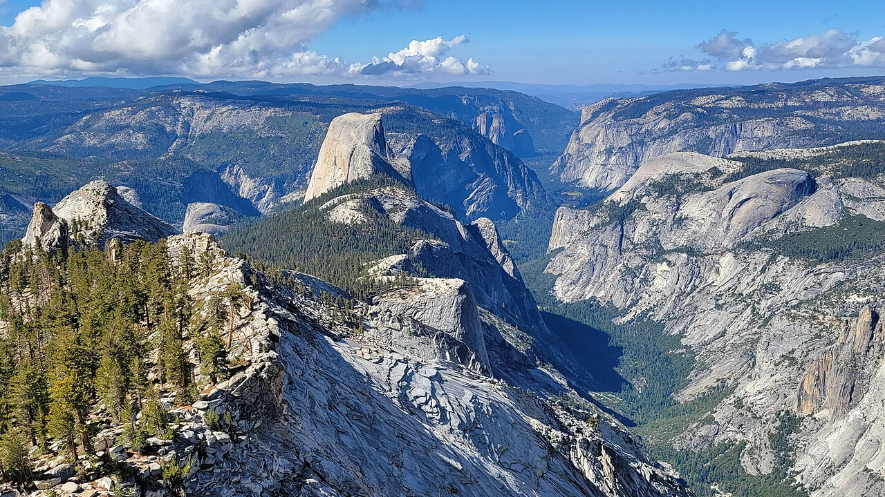
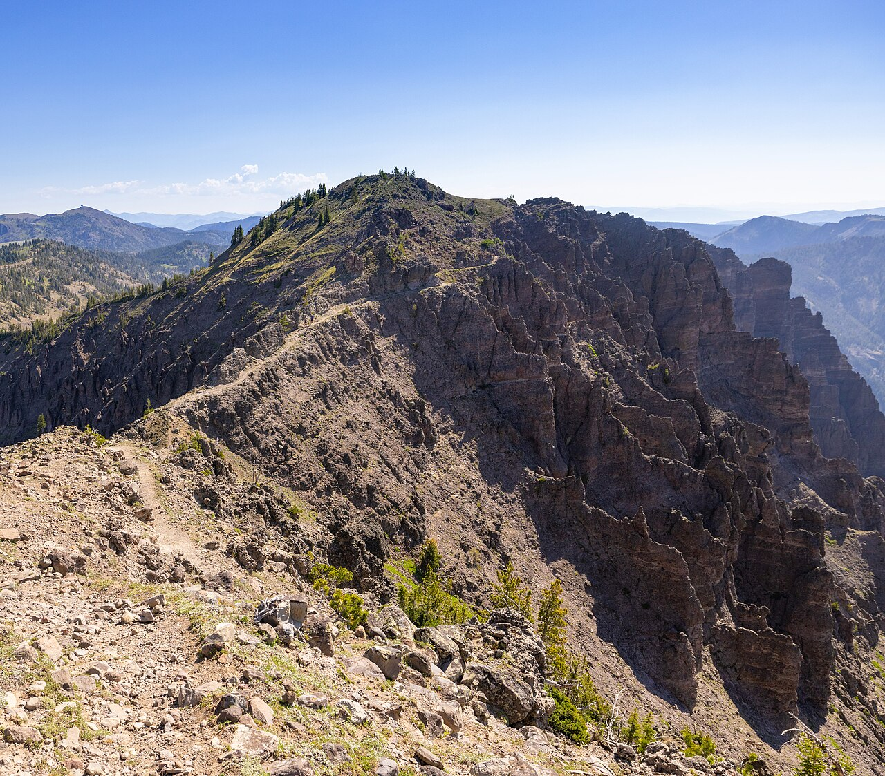
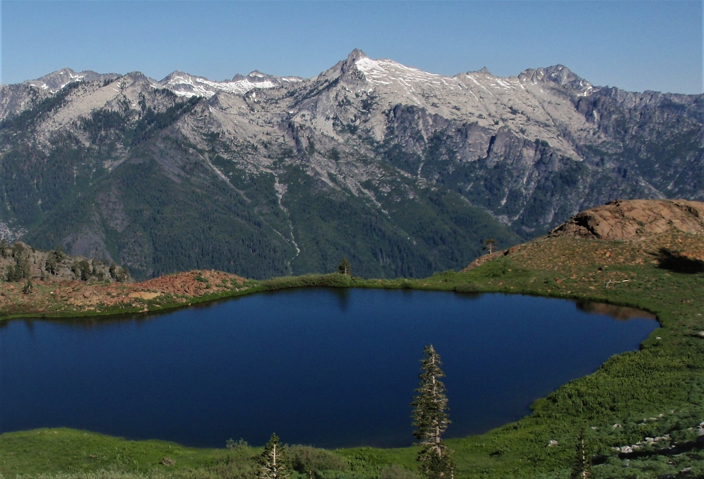
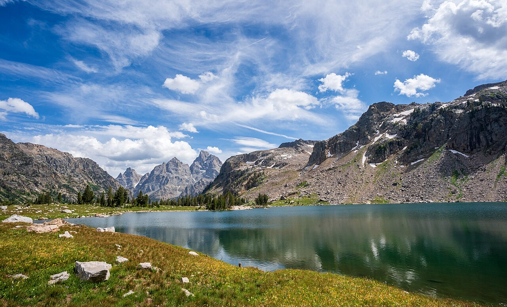
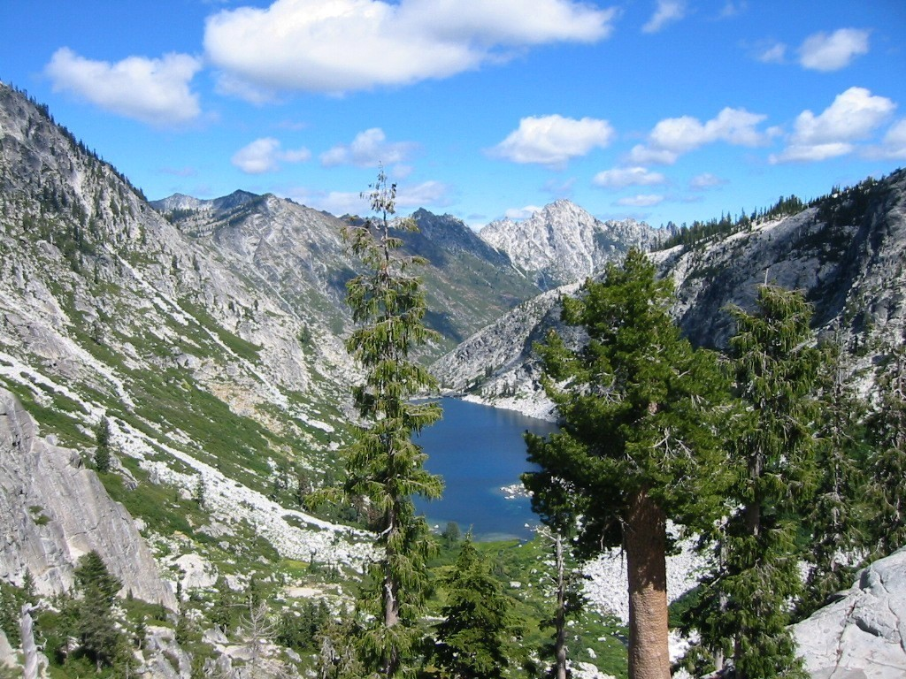

# Further afield

Printable guides to hikes and backpacking trips elsewhere in California and in the Rockies, shortest first. Each is a PDF to print and carry; the [README](README.md) explains what goes into one and how to print it so it survives rain.

| Hike | Distance | Climb | Time | Grade |
|---|---|---|---|---|
| [Looking down on Half Dome: Clouds Rest from Tenaya Lake](#looking-down-on-half-dome-clouds-rest-from-tenaya-lake-yosemite-national-park) (Yosemite National Park) | 12.1 mi | ≈ 3,120 ft | 7–10 h | Strenuous |
| [To the edge of Yellowstone: Bighorn Peak by Black Butte Creek](#to-the-edge-of-yellowstone-bighorn-peak-by-black-butte-creek-yellowstone-national-park) (Yellowstone National Park) | 12.4 mi | ≈ 3,300 ft | 7–9 h | Strenuous |
| [A lake behind every ridge: the Four Lakes Loop](#a-lake-behind-every-ridge-the-four-lakes-loop-trinity-alps-wilderness) (Trinity Alps Wilderness) | 18 mi | ≈ 6,730 ft | 3 days | Strenuous |
| [Behind the Grand Teton: Paintbrush Divide and Lake Solitude](#behind-the-grand-teton-paintbrush-divide-and-lake-solitude-grand-teton-national-park) (Grand Teton National Park) | 19.0 mi | ≈ 4,130 ft | 2 days | Strenuous |
| [Over the top: Canyon Creek to Sapphire Lake](#over-the-top-canyon-creek-to-sapphire-lake-trinity-alps-wilderness) (Trinity Alps Wilderness) | 25 mi | ≈ 5,090 ft | 3 days | Hard |

## Looking down on Half Dome: Clouds Rest from Tenaya Lake (Yosemite National Park)

*Yosemite National Park, California · a full-day hike*

Photo: Michael Kwok, CC BY 4.0 ([source](https://commons.wikimedia.org/wiki/File:Yosemite_Panorama_-_Flickr_-_Moo.The.Cow.jpg))

Walk out along a bare granite ridge until Half Dome is a thousand feet below you and all of Yosemite Valley lies beyond it, with no permit and no lottery. It takes a whole day at altitude, and one hill has to be climbed again on the way home.

**12.1 mi** out and back, as mapped · **≈ 3,120 ft** total climb · **7–10 h** · **Strenuous**: trail all the way; exposed ridge

[The guide (PDF)](out/clouds-rest/yosemite-clouds-rest-from-tenaya-lake.pdf) · [GPX: main](out/clouds-rest/clouds-rest-main.gpx) · [GPX: lakes](out/clouds-rest/clouds-rest-lakes.gpx)

## To the edge of Yellowstone: Bighorn Peak by Black Butte Creek (Yellowstone National Park)

*Yellowstone National Park, Montana · a full-day hike*

Photo: Yellowstone National Park, Public domain ([source](https://commons.wikimedia.org/wiki/File:Big_Horn_Peak.jpg))

Follow a creek out of the sagebrush, climb through forest and flower meadows, and come out on the grassy rim of the park, where the ground stops at a line of cliffs. Elk bugle below you, on a mountain built of buried forests. You pay with 3,300 feet of climbing in grizzly country.

**12.4 mi** out and back, as mapped · **≈ 3,300 ft** total climb · **7–9 h** · **Strenuous**: trail all the way; rocky crest

[The guide (PDF)](out/bighorn-peak/yellowstone-bighorn-peak-from-black-butte.pdf) · [GPX](out/bighorn-peak/bighorn-peak-main.gpx)

## A lake behind every ridge: the Four Lakes Loop (Trinity Alps Wilderness)

*Trinity Alps Wilderness, northern California · a three-day backpacking loop*

Photo: Tom Hilton, CC BY 2.0 ([source](https://commons.wikimedia.org/wiki/File:Diamond_Lake,_Sawtooth_Mountain.jpg))

Cross one high pass and the trail circles a single peak, handing you a new lake each time you top a ridge: four in seven miles, in rock that turns from rust-red to white as you go round. You pay for it on day one.

**18 mi** car to car · **≈ 6,730 ft** total climb · **3 days** · **Strenuous**: on trail throughout

[The guide (PDF)](out/four-lakes/trinity-alps-four-lakes-loop.pdf) · [GPX: long-canyon](out/four-lakes/four-lakes-long-canyon.gpx) · [GPX: stoney-ridge](out/four-lakes/four-lakes-stoney-ridge.gpx)

## Behind the Grand Teton: Paintbrush Divide and Lake Solitude (Grand Teton National Park)

*Grand Teton National Park, Wyoming · a two-day backpacking loop*

Photo: GrandTetonNPS, Public domain ([source](https://commons.wikimedia.org/wiki/File:Lake_Solitude_(53503523069).jpg))

Everyone photographs these peaks from the road. Climb one canyon, cross a pass at 10,700 ft and come down the next, and you see them from the side no road reaches, with moose in the willows on the way out. The pass keeps its snow into July, and you earn it.

**19.0 mi** car to car · **≈ 4,130 ft** total climb · **2 days** · **Strenuous**: on trail; snow on the pass early

[The guide (PDF)](out/paintbrush-cascade/grand-teton-paintbrush-cascade-loop.pdf) · [GPX](out/paintbrush-cascade/paintbrush-cascade-loop.gpx)

## Over the top: Canyon Creek to Sapphire Lake (Trinity Alps Wilderness)

*Trinity Alps Wilderness, northern California · a three-day mountain traverse*

Photo: Beyond the Trail (Flickr), CC BY-NC 2.0 ([source](https://www.flickr.com/photos/garytrinity/10963817393/))

Up the finest canyon in the Trinity Alps to its lakes, then off the map: a pathless crossing of the granite crest to three lakes almost nobody reaches this way, and out down a second valley.

**25 mi** trailhead to trailhead · **≈ 5,090 ft** climb; 5,410 ft descent · **3 days** · **Hard**: 3.1 mi off-trail, loose and steep

[The guide (PDF)](out/trinity-traverse/trinity-alps-canyon-creek-to-sapphire.pdf) · [GPX](out/trinity-traverse/trinity-traverse-main.gpx)

Figures are for the feet-and-miles edition. Each guide is 5 or 6 pages. Photos belong to their authors: see [CREDITS.md](CREDITS.md). Generated by `scripts/make_index.py`.
