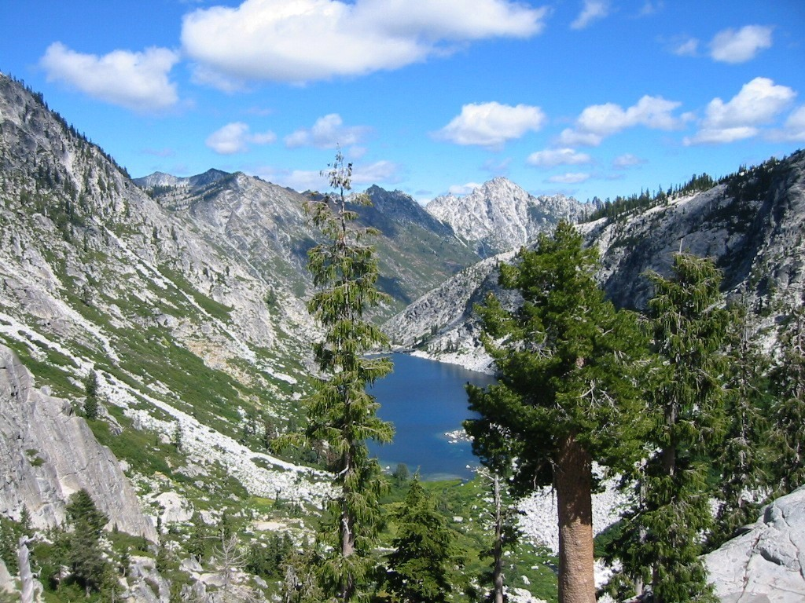

# Extremely hazardous advanced routes, documented for reference

These routes are advised against. Each began with someone asking online whether a route was feasible, and experienced backpackers answering that it carried a serious risk of injury or death. I compiled each one from published trip reports and terrain data to document what it involves. I have not walked them and I do not recommend them. For hikes to go and do, see [Bay Area hikes](BAY-AREA-HIKES.md) and [Further afield](FURTHER-AFIELD.md).

| Hike | Distance | Climb | Time | Grade |
|---|---|---|---|---|
| [The hazardous crossing from Canyon Creek to Sapphire Lake](#the-hazardous-crossing-from-canyon-creek-to-sapphire-lake-trinity-alps-wilderness) (Trinity Alps Wilderness) | 25 mi | ≈ 5,090 ft | 3 days | Extremely hazardous |

## The hazardous crossing from Canyon Creek to Sapphire Lake (Trinity Alps Wilderness)

*Trinity Alps Wilderness, California · an extremely hazardous advanced route, documented for reference*

Photo: Beyond the Trail (Flickr), CC BY-NC 2.0 ([source](https://www.flickr.com/photos/garytrinity/10963817393/))

**The author has not done this hike. This guide is compiled from published trip reports and a terrain model.**

A hiker asked online whether the granite crest between the Canyon Creek Lakes and Sapphire Lake can be crossed. Backpackers who know the range advised strongly against it, citing a serious risk of injury or death. This guide documents that crossing for reference. Do not attempt it on the strength of these pages.

**25 mi** trailhead to trailhead · **≈ 5,090 ft** climb; 5,410 ft descent · **3 days** · **Extremely hazardous**: 3.1 mi off-trail, loose and steep

[The guide (PDF)](out/trinity-traverse/trinity-alps-canyon-creek-to-sapphire.pdf) · [GPX](out/trinity-traverse/trinity-traverse-main.gpx)

Figures are for the feet-and-miles edition. Each guide is 5 or 6 pages. Photos belong to their authors: see [CREDITS.md](CREDITS.md). Generated by `scripts/make_index.py`.
